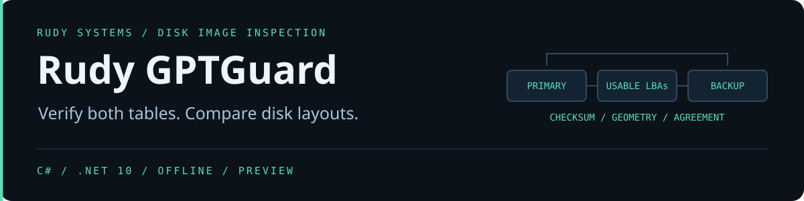

**Two GPT copies can each pass CRC checks and still describe different layouts.** GPTGuard checks the protective MBR and both GPT copies independently, then compares their evidence. Use it to check raw VM or firmware disk images before publishing them, or to catch layout changes between builds.

## Try the sample

Install the [.NET 10 runtime](https://dotnet.microsoft.com/download/dotnet/10.0), download the [portable preview](https://github.com/r4venrudy/rudy-gptguard/releases), compare the ZIP's SHA-256 to its entry in SHA256SUMS.txt, and extract it. Python 3 runs the optional synthetic fixture generator.

~~~sh
python examples/make_images.py samples
dotnet bin/gptguard.dll inspect samples/before.img
dotnet bin/gptguard.dll compare samples/before.img samples/after.img --fail-on-change
dotnet bin/gptguard.dll inspect samples/divergent.img
~~~

The comparison sample moves and renames one partition, removes a second, and adds a third. The divergent sample contains two individually valid GPT copies whose entry arrays differ. Generate 4 KiB sector fixtures with the following command and pass the same sector size to GPTGuard.

~~~sh
python examples/make_images.py samples4k --sector-size 4096
dotnet bin/gptguard.dll inspect samples4k/before.img --sector-size 4096
~~~

## What the report measures

| Evidence | Meaning |
| --- | --- |
| Protective MBR | Boot signature, single protective record, expected covered LBA range, and unexpected legacy records |
| Each GPT copy | Revision, header size and CRC32, reciprocal locations, usable range, entry array bounds, array CRC32 and SHA-256 |
| Partition entries | Partition type and unique GUID, slot, inclusive extent, UTF-16LE name, and a lossless 64-bit attributes string |
| Structural defects | Duplicate or empty IDs, invalid labels, out-of-range extents, and overlapping partitions, including nested overlaps |
| Agreement and change | Per-copy issues, conflicting valid copies, and semantic comparison by partition GUID when both input images are healthy |

The gptStatus field reports consistent, primary-only, backup-only, divergent or unreadable. A protective MBR defect can make an otherwise consistent image unhealthy. SHA-256 compares the complete declared entry arrays, including unused bytes, within one image. Cross-image comparisons describe parsed layout fields and exclude partition payloads and unused entry bytes.

## Exit codes

| Code | Meaning |
| --- | --- |
| 0 | Healthy inspection or successful comparison |
| 2 | Usage or input error |
| 3 | At least one input image is unhealthy |
| 4 | Healthy layouts differ and --fail-on-change was supplied |

## Build and verify

Use the .NET 10 SDK. The C# executable has no third-party runtime dependencies. Python 3.10+ runs the fixtures, tests, and ZIP packaging.

~~~sh
dotnet build src/GptGuard -c Release
python tests/integration.py dotnet src/GptGuard/bin/Release/net10.0/gptguard.dll

dotnet publish src/GptGuard -c Release --no-self-contained -p:UseAppHost=false -p:DebugType=None -o dist/publish
python tools/package.py dist/publish dist
~~~

CI tests Windows, Linux, and macOS and runs the same oracle against the packaged DLL. Use an offline, stable raw image file with 512-byte or 4096-byte logical sectors. Each copy is bounded to 16 MiB and 16,384 declared entries. The CLI opens images read-only and reads only GPT metadata regions. VHDX and QCOW2 containers require raw export first. CRC and copy agreement measure internal consistency. Authenticity, filesystem validity, and repair are outside the inspection scope.

[UEFI GPT disk layout reference](https://uefi.org/specs/UEFI/2.10/05_GUID_Partition_Table_Format.html)
